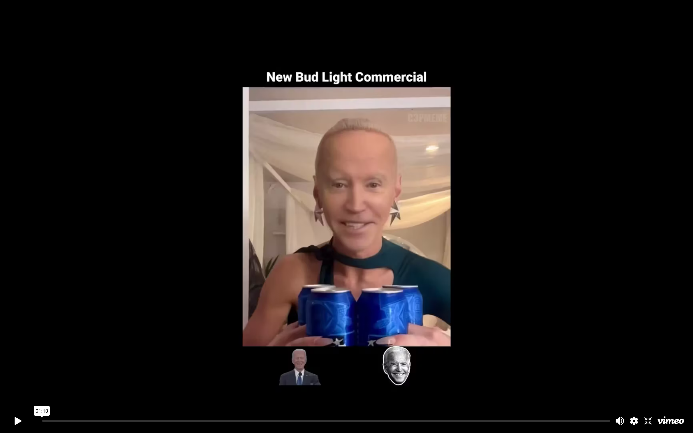

DEEPFAKE is both a video essay and a live installation, two forms that examine the cultural and emotional impact of synthetic media. From AI-powered memorials to non-consensual pornography, the essay looks at what happens when a likeness can be taken and a record rewritten without anyone's consent. Our bodies are no longer private, they are programmable.

The installation runs real-time deepfake technology in the room, so visitors watch their own faces being replaced and manipulated in front of them. Its goal is to put the audience on edge: once a likeness can be captured this easily, no one in the room knows when theirs might be used to violate their consent.

Produced by Artificial Nouveau Studio

Videography by Flora Reznik

<a href="/be-me/" class="btn" style="display:inline-block; margin-top:2rem; background:var(--color-card-bg); border:2px solid var(--color-accent-cyan); color:var(--color-accent-cyan); font-family:'JetBrains Mono',monospace; font-size:0.85rem; letter-spacing:0.1em; text-transform:uppercase; padding:0.75rem 1.5rem; text-decoration:none;">[ Do You Want To Be Me? ]</a>

---

<h4 style="margin-top:0;">[2025] Showcased at Peckham Digital</h4>

Peckham Digital &bull; London, United Kingdom

DEEPFAKE: A Video Essay was showcased at <a href="https://peckhamdigital.org/people/" target="_blank">Peckham Digital</a> 2025, a festival celebrating digital art and creative technology in South London.

